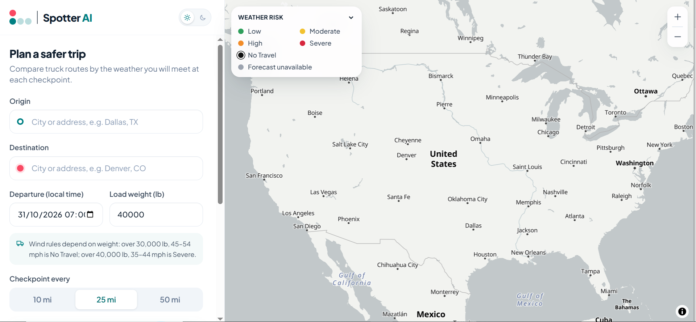
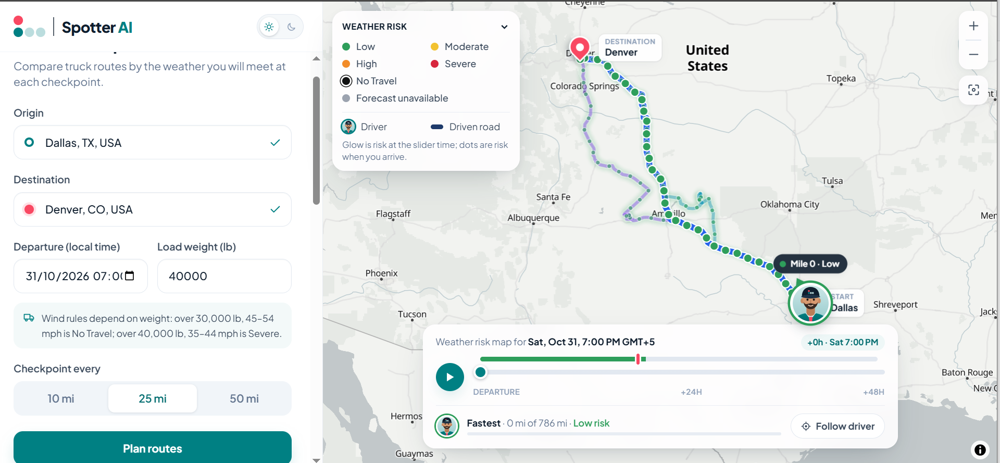
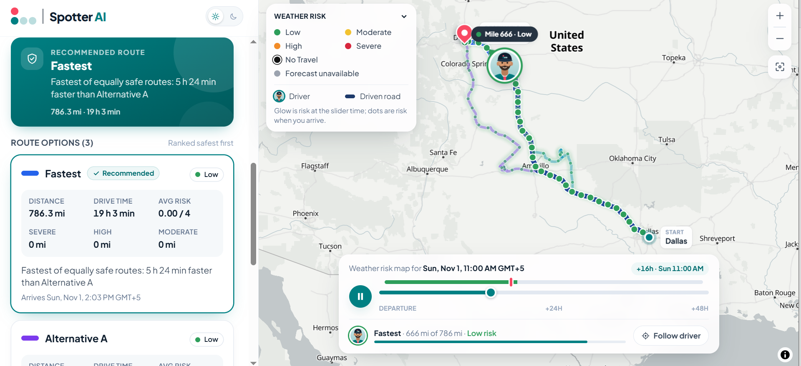
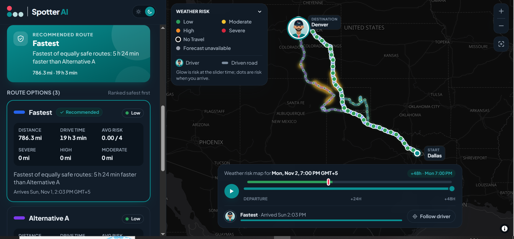
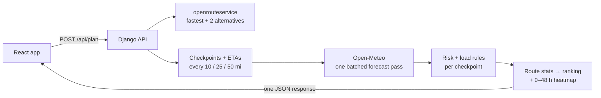

<div align="center">


# Spotter AI · Weather-Aware Truck Routing

**Pick the safest truck route by the weather you'll actually drive into, not the weather right now.**


<!-- Live demo: add the Vercel URL here · Walkthrough: add the Loom link here -->


</div>

---

## What it does

A driver enters an **origin**, a **destination**, a **departure time** and the **load weight**.
The app then:

- 🛣️ builds **up to 3 truck routes** with openrouteservice's heavy-goods-vehicle profile;
- 📍 drops **checkpoints every 10, 25 or 50 miles** and works out the truck's **ETA** at each one;
- 🌦️ fetches the **forecast for that ETA** (wind, rain, snow) and grades it **Low → No Travel**,
  raising the level for heavy loads in strong wind;
- 🏆 **recommends a route** (fewest Severe miles, then High miles, then average risk, then time)
  and says why in one line;
- 🗺️ draws everything on a map, with a **0–48 h weather-risk heatmap** you can scrub or play, and
  a **driver marker** that travels the route as time moves.

## Screenshots

<table>
  <tr>
    <td width="50%"></td>
    <td width="50%"></td>
  </tr>
  <tr>
    <td><b>Plan a trip</b>: pick places from suggestions, then set departure, load and checkpoint interval.</td>
    <td><b>Three routes</b>: risk-coloured checkpoints, start and destination pins, legend and forecast timeline.</td>
  </tr>
  <tr>
    <td width="50%"></td>
    <td width="50%"></td>
  </tr>
  <tr>
    <td><b>Playback</b>: the driver moves along the recommended route as the road already driven darkens.</td>
    <td><b>Dark mode</b>: the whole app and basemap switch, with the weather glow along the corridor.</td>
  </tr>
</table>

## How it works



| Step | What happens |
|---|---|
| **Routes** | The fastest truck route, plus alternatives forced through via points offset to each side. Near-duplicates, big detours and backtracking spurs are rejected. Routes are never invented. |
| **ETAs** | Interpolated from the router's own step-by-step travel times, so city and interstate speeds are both realistic. |
| **Weather** | Every checkpoint and heatmap point is snapped to the forecast grid, deduplicated and fetched in parallel batches, then cached. |
| **Risk** | The worst of wind, rain and snow from the brief's table; the wind-and-load rules can only raise it. Missing forecasts are reported as *unknown*, never as Low. |
| **Recommendation** | Sorted by `(No Travel, Severe, High miles, average risk, duration)`. The reason names the first criterion that differs, e.g. *"0 severe miles vs 18.4 on Alternative A"*. |
| **Heatmap** | 49 hourly risk values per corridor point arrive with the plan. The slider only swaps a GPU paint expression: **no network calls while scrubbing**. |


## Tech stack

| Layer | Tools |
|---|---|
| **Frontend** | React 18, TypeScript (strict), Vite, Tailwind CSS 4, MapLibre GL via react-map-gl, TanStack Query, Zustand, react-hook-form + zod, Downshift |
| **Backend** | Django 5, Django REST Framework, `requests` with pooling and retries, local-memory or Redis cache, gunicorn |
| **Data** | openrouteservice (routing, geocoding), Open-Meteo (weather), OpenFreeMap (map tiles) |
| **Quality** | pytest (206 tests), Vitest + Testing Library + MSW (112 tests), ruff, mypy strict, ESLint strict, Prettier |

## Project structure

```
├── backend/            Django API: all routing, weather, risk and ranking logic
│   └── routing/
│       ├── api/        views, validation, error envelope, rate limits
│       ├── services/   plan pipeline, alternatives, checkpoints, assessment, ranking, heatmap
│       ├── clients/    openrouteservice and Open-Meteo adapters
│       ├── domain/     the risk table and load rules (pure Python)
│       └── geo/        distances, interpolation, overlap
└── frontend/           React app: renders the plan, never re-computes risk
    └── src/features/   trip-form · results · map · forecast · driver · splash
```

## Run it locally

You need Python 3.12, Node 20 and a free [openrouteservice key](https://openrouteservice.org/dev/#/signup).

```bash
# 1 · API on http://localhost:8000
cd backend
python -m venv .venv && .venv/Scripts/activate     # macOS/Linux: source .venv/bin/activate
pip install -r requirements-dev.txt
cp .env.example .env                               # set ORS_API_KEY
python manage.py runserver

# 2 · App on http://localhost:5173
cd frontend
npm install
cp .env.example .env
npm run dev
```

**Run the checks:** `pytest` in `backend/`, and `npm test`, `npm run lint` and
`npm run typecheck` in `frontend/`.

## Deployment

- **API on Render:** the blueprint is [`render.yaml`](render.yaml). Set `ORS_API_KEY` and
  `CORS_ALLOWED_ORIGINS` in the dashboard.
- **App on Vercel:** set the root directory to `frontend` and `VITE_API_BASE_URL` to the Render
  URL plus `/api`.

More detail, including every environment variable, is in [backend/README.md](backend/README.md)
and [frontend/README.md](frontend/README.md).

---

<div align="center">
<sub>Routing © <a href="https://openrouteservice.org">openrouteservice.org</a> · Map data © OpenStreetMap contributors · Tiles © OpenFreeMap · Weather by <a href="https://open-meteo.com">Open-Meteo.com</a></sub>
</div>
